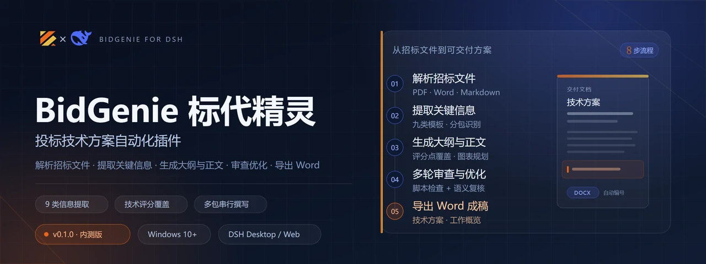

# BidGenie 标代精灵

**把复杂的技术标交给它：解析、大纲、正文到定稿，一步步走完。**

[](https://github.com/scifmat/dsh-bidgenie/blob/main/package.json)
[](https://www.npmjs.com/package/dsh-bidgenie)


BidGenie 是 [DSH（DeepSeek Harness）](https://github.com/deepseek-ai/deepseek-harness) 的投标技术方案插件：读取招标文件，提取关键信息，生成大纲与正文，完成审查与优化，最后导出可直接交付的 Word。项目状态保存在本地工作区，随时可以中断，下次说一句「继续这个项目」就能接着写。

## 功能

- **招标文件解析**：`.pdf` / `.docx` / `.doc` / `.md` 统一转为 Markdown。
- **关键信息提取**：按 9 类模板生成提取稿（公共 5 类 + 每个包 4 类），识别分包并确认。
- **大纲规划**：按技术评审因素生成章节树，校验评分覆盖率、层级、字数与图表配额。
- **正文撰写**：每批 4–6 章交给一个子智能体，自动生成含评审因素、内容要求、图表计划的任务书。
- **图表生成**：表格、Mermaid 示意图、终端模拟图按规划生成并渲染为 PNG。
- **审查与优化**：脚本检查 + 评分覆盖核对 + 图文核对，问题分 blocker / major / minor，修完复审。
- **导出 Word**：技术方案、工作概览、关键信息导出并自动校验，支持自定义导出样式。
- **断点续跑**：状态机记录阶段与进度，中途关闭不影响已有内容。

## 使用流程

```text
投标人 → 初始化 → 提取招标文件 → 撰写准备 → 大纲 → 正文 → 审查/优化 → 定稿 → 导出 Word
```

| 阶段 | 可以这样说 | 主要产出 |
|---|---|---|
| 投标人 | 「帮我建一个投标人」 | `dsh/bidders/<投标人>/` 下的资料 |
| 初始化 | 「开始这个项目」 | `project.json`、`state.json` |
| 提取 | 「继续提取关键信息」 | `extraction/` 下的提取稿 |
| 撰写准备 | 「准备写方案」 | 包目录、`package-meta.json` |
| 大纲 | 「继续生成大纲」 | `outline.json` 与章节文件树 |
| 正文 | 「继续写正文」 | `chapters/**/*.md`、图表 PNG |
| 审查/优化 | 「继续审查」/「继续优化」 | `reviews/issues.json`、`review-report.md` |
| 定稿/导出 | 「可以定稿」/「导出 Word」 | 锁定当前包并导出 DOCX |

多包项目只需在撰写准备阶段选一次要写的包，之后按包串行走完，上一包完成后再进入下一包。

## 安装

要求：Windows 10 或更高；DSH Desktop 或 Web 0.2.x。无需预装 Python / Node.js，插件使用 DSH 自带运行时。

1. 打开 DSH 的「插件」→「添加插件」，填写 npm 包名：

   ```text
   dsh-bidgenie
   ```

   或填写仓库地址 `https://github.com/scifmat/dsh-bidgenie`（两种安装方式都能用；**npm 安装才能在面板里看到「更新」提示**，GitHub 安装需手动 `git pull` 更新）。安装完成后重启 DSH。

2. 首次安装后，在插件目录运行一次依赖修复工具（安装 PDF、Word 相关依赖，约 100 MB）：

   ```powershell
   tools\repair-env.cmd
   ```

   默认使用国内镜像；`tools\repair-env.cmd -DryRun` 只查看计划，`-Mirror <url>` 可换源。

3. 打开（或新建）一个工作区，左栏「标代精灵」→「环境检查」，确认必需项通过。

## 快速开始

1. 在 DSH 打开一个工作区，插件数据会写入该工作区的 `dsh/` 目录。
2. 左栏「标代精灵」→「投标人」，新建公司或个人资料，并设为当前投标人。
3. 在对话框上传招标文件，说「**帮我写技术方案**」，按提示确认分包、要写的包、字数、人员 / 设备 / 工期。
4. 中途可以随时停下；下次打开工作区说「继续这个项目」即可接着走。
5. 内容确认后说「**可以定稿**」，再说「**导出 Word**」。

## 产物位置

| 产物 | 位置 |
|---|---|
| 技术方案 DOCX | `<项目>/packages/package-N-<时间戳>/export/` |
| 工作概览 MD + DOCX | 同上 |
| 关键信息 DOCX | `<项目>/exports/` |
| 提取稿 | `<项目>/extraction/` |
| 投标人资料 | `<工作区>/dsh/bidders/` |

导出的 Word 不含封面和目录；如招标文件要求，请在 Word 中补充。技术方案与关键信息文档使用 Word 自动标题编号。

## 适用边界

- 只处理技术方案，不写商务标、报价、资格文件与合同分包内容。
- 不代填证明材料，不编造证书编号、检测结论或业绩金额；需要用户提供的材料会在特殊章节中列出。
- 不含 OCR；纯图片扫描件请先转为可选中文字的 PDF 或 Word。
- 不自动提交投标，也不替代人工复核。

## 环境依赖

| 项目 | 说明 |
|---|---|
| 系统 | Windows 10 或更高（当前仅在 Windows 验证） |
| 宿主 | DSH Desktop / Web 0.2.x |
| Python / Node.js | 使用 DSH 自带运行时，无需单独安装 |
| 可选组件 | Chrome / Edge（示意图渲染）、Word 或 LibreOffice（`.doc` 转换）、Windows 中文字体 |
| 磁盘 | 建议预留 500 MB 以上 |

## 反馈与许可

- 问题反馈：[GitHub Issues](https://github.com/scifmat/dsh-bidgenie/issues)。请附插件版本、DSH 版本与复现步骤，不要粘贴证件号、账号等敏感信息。
- 许可：**PolyForm Noncommercial 1.0.0**，仅限非商业使用；商业授权请另行联系。全文见 [LICENSE](LICENSE)。
- 官网：[www.bidgenie.cn](https://www.bidgenie.cn)　·　商业授权：[bidgenie@163.com](mailto:bidgenie@163.com)
