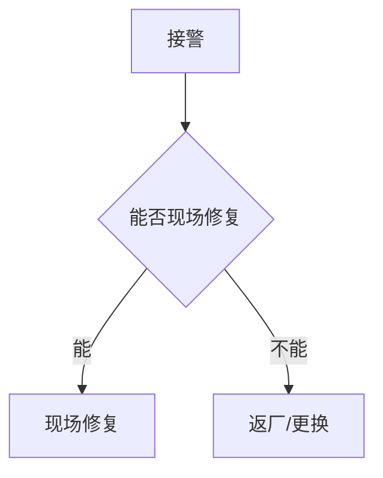
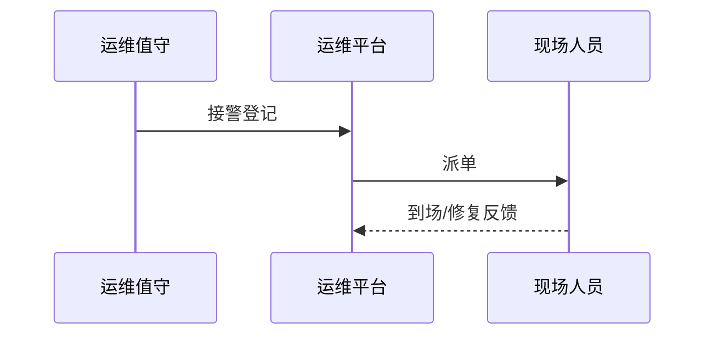
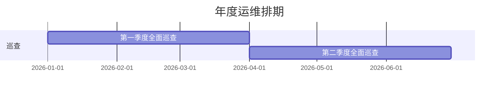
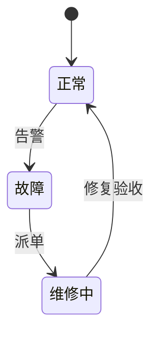
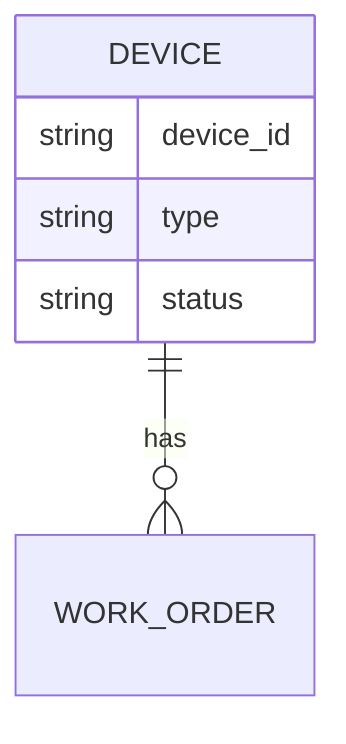
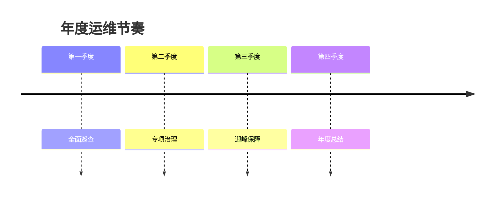
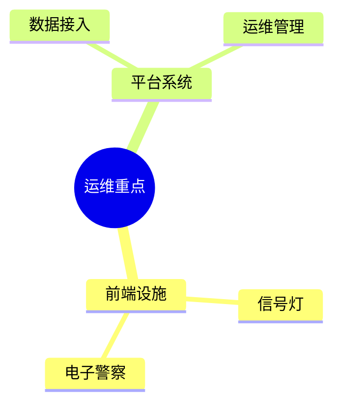
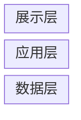
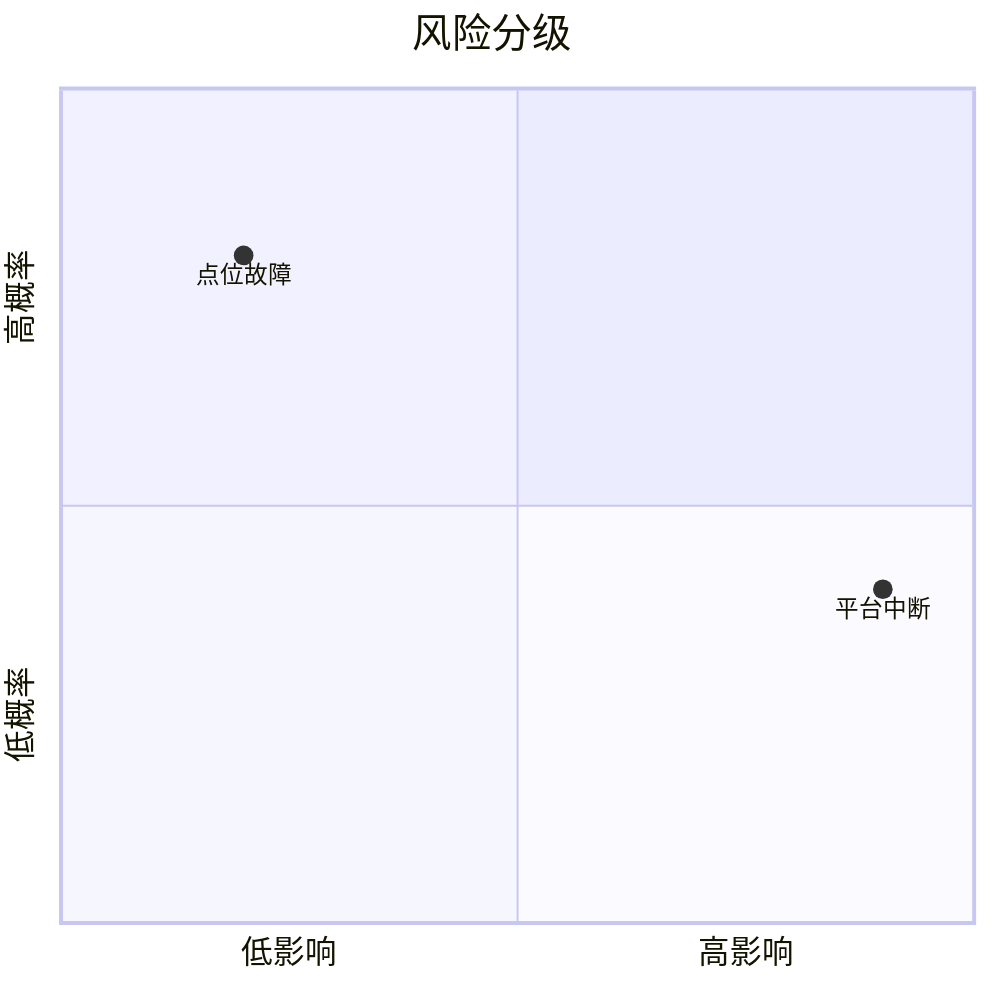
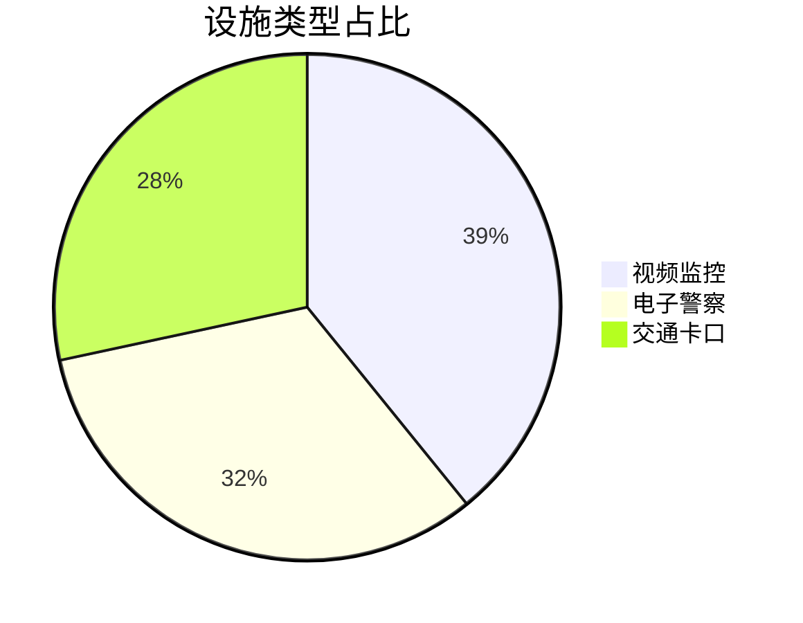

# mermaid 类型与最小语法骨架

## flowchart



- 方向默认 TB；节点 6–7、判定 ≤3、回边 ≤1；超过 7 节点先拆图，不要只靠改 LR 硬塞。
- 节点 ≤12；标签 ≤10 汉字。

## sequenceDiagram



- 参与者用正文中的真实角色/系统名；不要超过 6 个参与者。

## gantt



- 日期必须来自工期计划/正文；不得虚构。

## stateDiagram-v2



## erDiagram



## timeline



## mindmap



## block-beta



## architecture-beta


## quadrantChart



## pie / xychart-beta



```mermaid
xychart-beta
  title 月度工单量
  x-axis [1月, 2月, 3月]
  y-axis "工单数" 0 --> 500
  bar [320, 280, 350]
```

- pie/xychart 只能使用有来源的数据；没有数据改用 flowchart/table。
